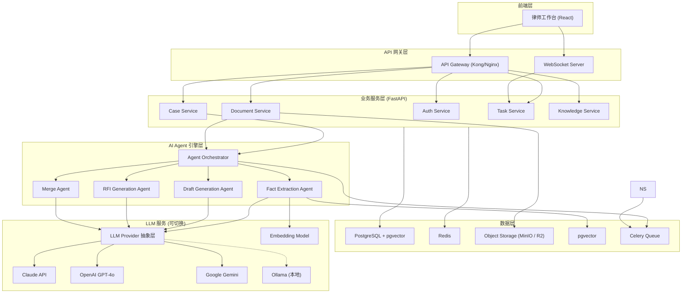
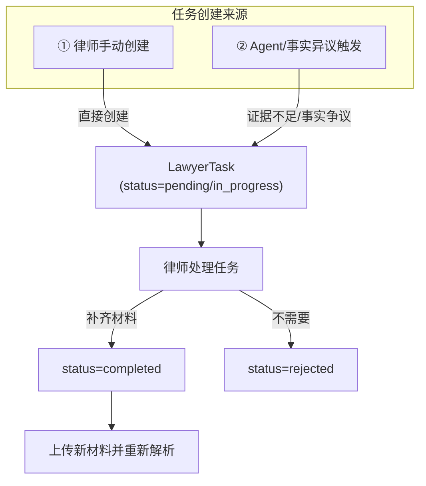
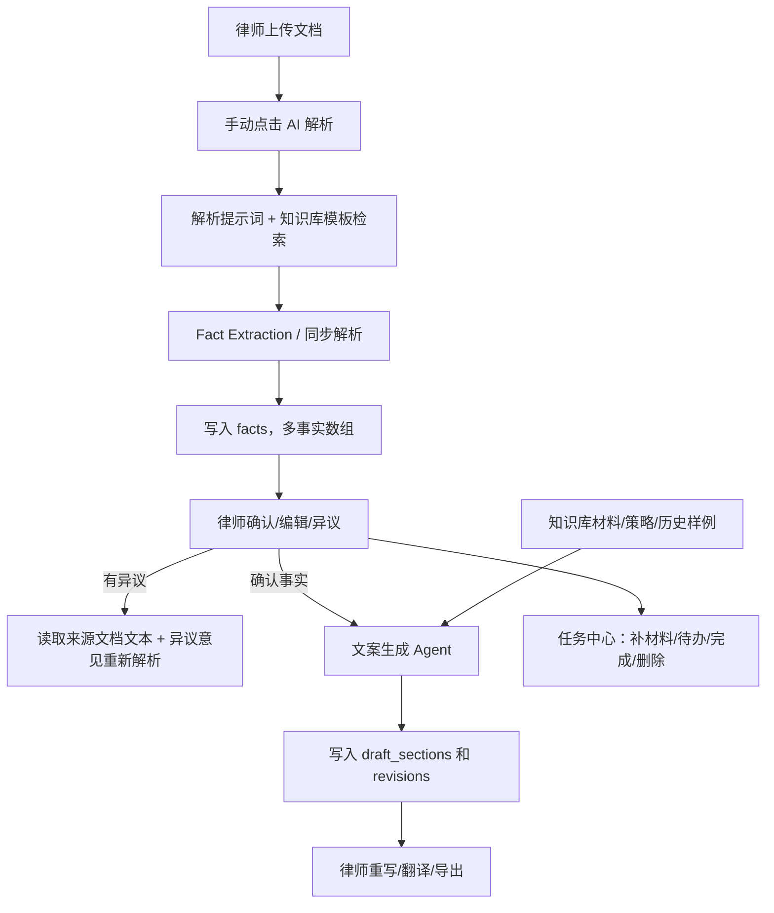
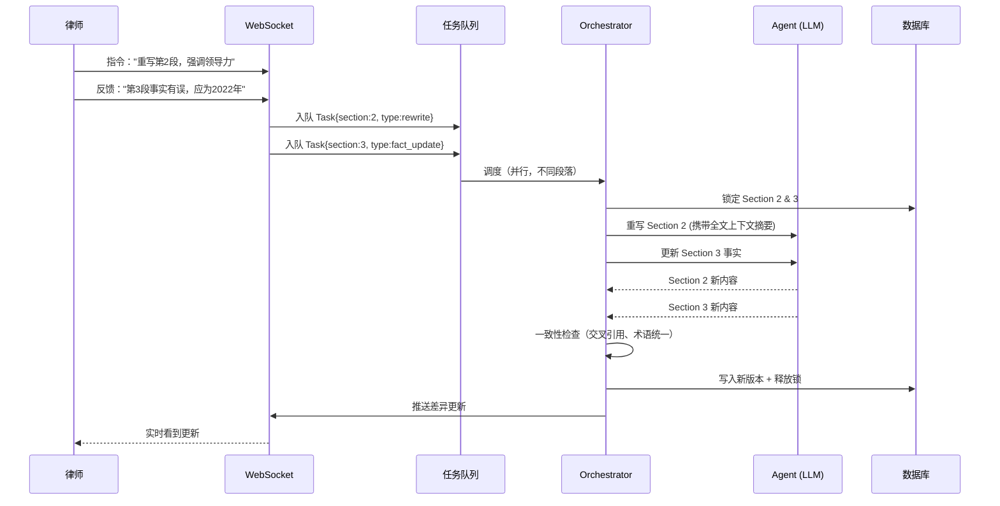
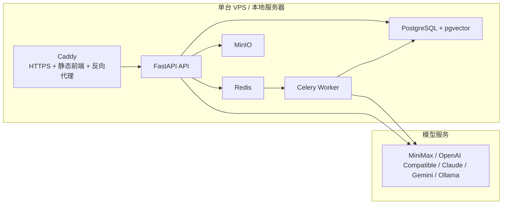

# AI Agent 移民律师协作平台 — 技术实现文档 V1.1

> 当前文档以本仓库 2026-04-26 的实现为准。早期设想中尚未落地的 Supabase/Railway、LiteLLM、TipTap、补件邮件发送等内容统一降级为后续规划，不再描述为当前功能。

---

## 0. 当前实现一致性校正

| 原文档说法 | 当前实现 |
|------------|----------|
| 客户不登录系统，仅通过邮件沟通 | 当前版本仍以律师操作为主，但案件中已经维护客户姓名、邮箱、电话；客户联系信息存储在 `cases.metadata`。 |
| LLM 抽象层使用 LiteLLM | 当前实现为 `backend/app/llm/provider.py` 自研 `LLMService`，通过 OpenAI-compatible `/chat/completions` 适配 MiniMax、OpenAI Compatible、Ollama 等 Provider。 |
| 前端固定暗色玻璃风格 | 当前支持「明亮版」和「经典暗色版」两套主题，律师在设置页自行选择，偏好保存在浏览器 localStorage。 |
| 文档上传后自动解析 | 当前实现为上传后手动触发解析；解析弹窗支持律师提示词和知识库检索。 |
| 上传页只能下载一种文件 | 当前上传页同时提供「原始文件」下载和「解析文案」导出；解析文案包含当前文档关联的全部事实。 |
| 一篇文档只抽取一条事实 | 当前实现允许一篇文档抽取多条事实；LLM 抽取链路返回 JSON array，同步解析模拟也按文档类型生成多条事实。 |
| 事实异议只是标记状态 | 当前实现会根据律师异议重新解析；如能读取来源文档，会把原文上下文一并交给 LLM 生成修正版事实。 |
| Agent 输出可能含 `<think>` | 当前所有主要 LLM 调用链路会清理 `<think>...</think>` 推理标签。 |
| 任务只能审批 | 当前任务中心支持状态修改、标记完成、软删除和恢复。 |
| 生产部署依赖多平台免费层 | 当前推荐两种经济方案：单台 VPS + Docker Compose + Caddy，或便宜托管云服务组合。 |

---

## 1. 项目概述

### 1.1 业务目标

构建一个 **Agent-Lawyer 智能协作平台**，通过 AI Agent 辅助移民律师完成 EB-1A 等移民申请文案的撰写。

- **核心协作 (Agent ↔ Lawyer)**：法律策略对齐、辩护逻辑挖掘、多版本文案生成、事实核实与审批

### 1.2 多租户平台定位

本系统是一个 **多律所、多律师** 的 SaaS 平台，组织层级为：

```
Organization (律所)
├── Team (团队/部门)
│   ├── Lawyer (律师) ── 可负责多个 Case
│   └── Associate (助理)
└── Client Contact (客户信息) ── 当前由律师维护姓名、邮箱、电话
```

**关键约束**：
- 律所之间数据完全隔离（租户隔离）
- 同一律所内，律师只能看到自己参与的案件（除 FirmAdmin 外）
- 当前客户不直接使用平台，律师代为操作案件、文档、事实和任务流程
- 需要客户补件时，当前通过任务中心登记和追踪，邮件发送属于后续增强

### 1.3 核心技术挑战

> [!IMPORTANT]
> **高并发 Agent 调度**：当多位律师同时在线编辑反馈时，如何快速、局部地重写法律文案段落并保持上下文一致性？这是本系统的核心技术难点。

---

## 2. 系统架构

### 2.1 整体架构图



### 2.2 技术选型

| 层次 | 技术 | 理由 |
|------|------|------|
| **前端** | React 18 + TypeScript + Vite | 组件化、类型安全、快速构建 |
| **前端 i18n** | react-i18next + i18next | 多语言 UI，支持中/英/日/韩等语言切换 |
| **实时协作** | FastAPI WebSocket | 当前提供案件级 WebSocket 通道，后续可扩展编辑协作 |
| **富文本/文案编辑** | React 文案工作台 | 当前以文本段落、版本、重写、导出为主；TipTap 属后续规划 |
| **后端框架** | Python 3.11 + FastAPI | 异步高性能、自动 OpenAPI 文档、Python AI 生态成熟 |
| **LLM 抽象层** | 自研 LLMService | OpenAI-compatible HTTP 适配 MiniMax/OpenAI/Ollama 等模型，并统一清理 `<think>` 标签 |
| **异步任务** | Celery + Redis (Broker) | Agent 任务异步分发、优先级队列、重试机制 |
| **ORM** | SQLAlchemy 2.0 + Alembic | 异步 ORM、类型安全、数据库迁移管理 |
| **数据库** | PostgreSQL 16 + pgvector | JSONB 支持、全文搜索、事务安全；当前 Docker Compose 本地/单机部署 |
| **缓存** | Redis 7 | Celery Broker/Result Backend、缓存和后续锁能力 |
| **对象存储** | MinIO / Cloudflare R2 | 当前本地默认 MinIO，云端可切换 S3-compatible 存储 |
| **搜索引擎** | pgvector (PostgreSQL 扩展) | 语义向量搜索，无需额外服务，降低复杂度 |
| **Embedding** | sentence-transformers (本地) | 事实语义检索、历史案例匹配 |
| **文档解析** | PyMuPDF + python-docx + Tesseract OCR | Python 原生多格式解析，无需 Java (Tika) |
| **容器化** | Docker + Docker Compose | 开发一致性、部署标准化 |
| **CI/CD** | GitHub Actions | 自动化测试与部署 |

---

## 3. 数据库设计

### 3.0 当前数据库实现摘要

当前数据库通过 Alembic 管理，已执行到 `008_add_deploy_query_indexes.py`，`alembic check` 无新增差异。核心实现点：

- `users.profile` 使用 JSONB 保存律师个人扩展信息，目前包括 `phone`。
- `organizations.settings` 使用 JSONB 保存律所级模型配置：`llm_provider`、`llm_model`、`llm_base_url`、`api_key`。
- `cases.metadata` 使用 JSONB 保存客户信息：`client_name`、`client_email`、`client_phone`；创建和编辑案件时要求客户邮箱或电话至少一个。
- `documents` 记录上传文件、类型、解析状态、对象存储路径；上传页提供“原始文件”下载和“解析文案”导出。
- `facts` 记录多条事实，支持 `source_document_id` 回链来源文档；异议重解析会保留 `original_content`、`dispute_comment` 和 `reparse_source`。
- `lawyer_tasks` 支持任务状态更新、完成、删除、恢复。
- `knowledge_items` 作为提示词模板、文档模板、样例和 Agent 策略的知识库。
- 关键索引覆盖案件列表、文档列表、事实列表、任务列表、知识库筛选、文档解析导出和 Agent 任务查询。
- Redis 缓存覆盖案件、文档、事实、文案、任务等高频列表接口，并在写入/状态变更/Agent 完成时按案件维度失效。
- LLM 调用支持短 TTL 缓存，重复请求可减少模型成本；模型输出统一清理 `<think>` 标签后落库。
- 文档、事实、任务、文案、案件和会话接口均按案件成员校验访问权限，避免通过资源 ID 跨案件读写。
- 请求日志包含 `request_id`、路径、状态码和耗时；Agent 任务写入 `latency_ms`、`error_message` 和结构化 `output_result`，便于部署后排查。

### 3.1 核心 ER 关系

```mermaid
erDiagram
    Organizations ||--o{ Teams : has
    Organizations ||--o{ Org_Members : has
    Organizations {
        uuid id PK
        string name "律所名称"
        string slug "URL标识"
        jsonb settings "配额/LLM配置"
        enum plan "free|pro|enterprise"
        timestamp created_at
    }

    Teams {
        uuid id PK
        uuid org_id FK
        string name "团队名称"
        timestamp created_at
    }

    Users ||--o{ Org_Members : joins
    Users {
        uuid id PK
        string email
        string name
        string password_hash
        bool is_active
        jsonb profile
        timestamp created_at
    }

    Org_Members {
        uuid id PK
        uuid org_id FK
        uuid user_id FK
        uuid team_id FK "可选"
        enum role "firm_admin|lead_lawyer|associate"
        jsonb permissions
        timestamp joined_at
    }

    Cases ||--o{ Case_Members : has
    Cases ||--o{ Documents : contains
    Cases ||--o{ Facts : has
    Cases ||--o{ Lawyer_Tasks : has
    Cases {
        uuid id PK
        uuid org_id FK "租户隔离键"
        string title
        enum case_type "EB1A|EB1B|NIW|O1A"
        enum status "intake|fact_extraction|drafting|review|submitted"
        uuid lead_lawyer_id FK
        jsonb metadata
        timestamp created_at
    }

    Case_Members {
        uuid id PK
        uuid case_id FK
        uuid user_id FK
        enum role "lead_lawyer|associate"
        jsonb permissions
    }

    Document_Categories {
        uuid id PK
        uuid org_id FK "NULL=system preset"
        string name "award|patent|publication..."
        string display_name
        string icon
        int sort_order
        bool is_system
        timestamp created_at
    }

    Documents ||--o{ Document_Versions : has
    Documents {
        uuid id PK
        uuid case_id FK
        uuid category_id FK
        string filename
        enum doc_type "petition_letter|evidence|reference_letter|rfi_response"
        string storage_path "org/.../case/.../role/category/file"
        uuid uploader_id FK
        enum uploader_role "lawyer|agent"
        enum parse_status "pending|parsing|parsed|failed"
        jsonb extracted_metadata
        timestamp created_at
    }

    Document_Versions {
        uuid id PK
        uuid document_id FK
        int version_number
        string content_snapshot
        enum editor_role "agent|lawyer"
        uuid editor_id FK
        string change_summary
        jsonb diff_data
        timestamp created_at
    }

    Facts ||--o{ Fact_Collaboration : has
    Facts {
        uuid id PK
        uuid case_id FK
        uuid source_document_id FK
        string category
        text content
        jsonb structured_data
        enum status "extracted|lawyer_approved|disputed"
        float confidence_score
        timestamp created_at
    }

    Fact_Collaboration {
        uuid id PK
        uuid fact_id FK
        uuid user_id FK
        enum action "confirm|dispute|edit|approve"
        text comment
        jsonb before_value
        jsonb after_value
        timestamp created_at
    }

    Lawyer_Tasks {
        uuid id PK
        uuid case_id FK
        string task_type "fact_confirmation|document_upload|detail_input|feedback"
        string created_by_role "lawyer|agent"
        uuid created_by_id FK "律师"
        uuid approved_by_id FK "可选"
        string title
        text description
        text legal_rationale
        string status "pending_approval|pending|in_progress|completed|overdue|rejected"
        date due_date
        jsonb attachments
        bool is_deleted
        timestamp created_at
    }

    Draft_Sections {
        uuid id PK
        uuid case_id FK
        uuid document_id FK
        int section_order
        string section_title
        text content
        enum criterion "criterion_1|criterion_2|criterion_3"
        enum status "draft|pending_review|lawyer_approved|final"
        jsonb pending_slots
        timestamp created_at
    }

    Agent_Tasks {
        uuid id PK
        uuid case_id FK
        enum task_type "fact_extract|draft_generate|rfi_generate|merge|rewrite_section"
        jsonb input_params
        jsonb output_result
        enum status "queued|processing|completed|failed|cancelled"
        int priority
        string llm_model
        int token_usage
        int latency_ms
        timestamp created_at
    }

    User_Sessions {
        uuid id PK
        uuid user_id FK
        uuid case_id FK
        string page_context
        jsonb draft_state
        jsonb ui_state
        timestamp last_active_at
    }

    Organizations ||--o{ Cases : scopes
    Organizations ||--o{ Document_Categories : defines
    Document_Categories ||--o{ Documents : categorizes
    Cases ||--o{ Draft_Sections : has
    Cases ||--o{ Agent_Tasks : has
    Draft_Sections ||--o{ Document_Versions : tracked_by
```



### 3.2 多租户隔离策略

**数据隔离方式**：共享数据库 + `org_id` / `case_members` 行级过滤。当前由后端查询条件控制访问范围；数据库 RLS 可作为生产强化项。

```sql
-- 可选生产强化：所有租户共享表，通过 org_id 字段隔离
ALTER TABLE cases ENABLE ROW LEVEL SECURITY;

CREATE POLICY "tenant_isolation" ON cases
  USING (org_id = current_setting('app.current_org_id')::uuid);

CREATE POLICY "member_access" ON cases
  USING (id IN (
    SELECT case_id FROM case_members WHERE user_id = current_setting('app.current_user_id')::uuid
  ));
```

**后端租户中间件** (FastAPI)：
```python
# middleware/tenant.py
class TenantMiddleware:
    """从 JWT 中提取 org_id，注入到请求上下文和数据库会话"""
    async def __call__(self, request, call_next):
        token_data = decode_jwt(request.headers.get("Authorization"))
        request.state.org_id = token_data["org_id"]
        request.state.user_id = token_data["user_id"]
        request.state.role = token_data["role"]
        # 所有数据库查询自动带上 org_id 过滤
        response = await call_next(request)
        return response
```

**权限层级**：

| 角色 | 数据范围 | 关键权限 |
|------|---------|----------|
| **SuperAdmin** | 全平台 | 管理所有律所、系统配置 |
| **FirmAdmin** | 本律所全部案件 | 团队管理、律师分配、账单、LLM 配额 |
| **LeadLawyer** | 自己负责的案件 | 创建案件、驱动 Agent、审核事实、终审文案、管理补材料任务 |
| **Associate** | 被分配参与的案件 | 协助编辑、事实核查、文档上传 |

### 3.2 关键索引设计

```sql
-- 高频查询优化
CREATE INDEX idx_cases_lawyer ON cases(lead_lawyer_id, status);
CREATE INDEX idx_cases_deleted_updated ON cases(is_deleted, updated_at DESC);
CREATE INDEX idx_facts_case_status ON facts(case_id, status);
CREATE INDEX idx_facts_case_deleted_updated ON facts(case_id, is_deleted, updated_at DESC);
CREATE INDEX idx_facts_source_document_deleted_created ON facts(source_document_id, is_deleted, created_at DESC);
CREATE INDEX idx_client_tasks_case_deleted ON client_tasks(case_id, is_deleted);
CREATE INDEX idx_client_tasks_case_deleted_updated ON client_tasks(case_id, is_deleted, updated_at DESC);
CREATE INDEX idx_doc_versions_doc ON document_versions(document_id, version_number DESC);
CREATE INDEX idx_agent_tasks_case ON agent_tasks(case_id, status, priority);
CREATE INDEX idx_agent_tasks_case_updated ON agent_tasks(case_id, updated_at DESC);
CREATE INDEX idx_draft_sections_case ON draft_sections(case_id, section_order);
CREATE INDEX idx_draft_sections_case_deleted_updated ON draft_sections(case_id, is_deleted, updated_at DESC);
CREATE INDEX idx_documents_case_deleted_type_created ON documents(case_id, is_deleted, doc_type, created_at DESC);
CREATE INDEX idx_documents_case_deleted_uploader_created ON documents(case_id, is_deleted, uploader_role, created_at DESC);

-- JSONB 查询索引
CREATE INDEX idx_facts_structured ON facts USING GIN(structured_data);
```

### 3.3 文档分类与分目录存储

文档按 **律所 / 案件 / 上传者角色 / 文件分类** 四级目录组织：

```
{bucket}/
└── org/{org_id}/
    └── case/{case_id}/
        ├── lawyer/
        │   ├── petition_letter/        # 申请信草稿
        │   ├── reference_letter/       # 推荐信
        │   ├── award/                  # 奖项证明
        │   ├── patent/                 # 专利文件
        │   ├── publication/            # 论文
        │   ├── citation/               # 引用证据
        │   ├── employment/             # 工作证明
        │   ├── media/                  # 媒体报道
        │   └── other/                  # 其他
        └── agent/
            └── extracted_facts.json
```

**系统预设分类**（`is_system=true`，不可删除）：

| name | display_name | 典型文件 |
|------|-------------|----------|
| `award` | 奖项证明 | 获奖证书、评审记录 |
| `patent` | 专利文件 | 专利证书、审批文件 |
| `publication` | 论文/出版物 | 期刊论文、会议论文 |
| `citation` | 引用证据 | Google Scholar 截图、引用报告 |
| `employment` | 工作证明 | Offer Letter、离职证明 |
| `media` | 媒体报道 | 新闻报道、采访记录 |
| `membership` | 协会会员 | 会员证书、评审邀请 |
| `reference_letter` | 推荐信 | 推荐人推荐信 |
| `petition_letter` | 申请信 | Petition Letter 草稿 |
| `rfi_response` | 补件回复 | RFI 响应材料 |
| `other` | 其他 | 护照、身份证明等 |

**律所自定义分类**：FirmAdmin 可在后台新增分类（`is_system=false`），如"商业计划书"、"审计报告"等，自定义图标和排序。

```python
def build_storage_path(org_id, case_id, uploader_role, category_name, filename):
    safe_name = f"{uuid4().hex[:8]}_{sanitize(filename)}"
    return f"org/{org_id}/case/{case_id}/{uploader_role}/{category_name}/{safe_name}"
```

### 3.4 自动保存与进度恢复

律师在使用过程中可随时保存进度，下次登录后继续。

**保存机制**：
- **自动保存**：前端每 30 秒或内容变更时自动触发，写入 `User_Sessions` 表
- **手动保存**：用户点击"保存"按钮立即持久化
- **离线草稿**：浏览器 localStorage 作为兜底，防止网络中断丢失

**保存内容** (`User_Sessions.draft_state`)：
```json
{
  "editor_content": "当前文案编辑状态 JSON",
  "pending_inputs": {"section_3": "用户正在填写的补充内容..."},
  "fact_confirmations": {"fact_12": "confirmed", "fact_15": "disputed"},
  "scroll_position": 1280,
  "active_panel": "editor",
  "selected_version": "version_b"
}
```

**恢复流程**：
```
用户登录 → 检查 User_Sessions (case_id + user_id)
  ├── 有未完成会话 → 弹出提示 "您上次编辑到 XX，是否继续？"
  │   ├── 继续 → 恢复 draft_state 到编辑器
  │   └── 放弃 → 清除会话，加载最新版本
  └── 无会话 → 正常加载
```

**API**：
```
PUT    /api/v1/sessions/:case_id          # 保存/更新会话进度
GET    /api/v1/sessions/:case_id          # 获取最近会话
DELETE /api/v1/sessions/:case_id          # 清除会话
```

### 3.5 补材料任务工作流



| 来源 | 初始状态 | 说明 |
|------|---------|------|
| **律师手动创建** | `pending` / `in_progress` | 律师直接登记补材料、审核、内部待办 |
| **事实异议触发** | `pending` | 对有争议事实提交补材料任务 |
| **Agent 触发** | `pending_approval` | 后续可由 Agent 发现证据不足后创建待律师确认任务 |

当前任务中心支持状态修改、标记完成、软删除、恢复。邮件草稿生成和发送属于后续增强。

---

## 4. Agent 调度引擎设计

> [!IMPORTANT]
> 这是系统核心——解决高并发下多用户同时反馈时的局部重写与上下文一致性问题。

### 4.0 当前 Agent 流程

当前实现以“律师显式触发 + Celery 异步任务 + 可审计结果落库”为主：



当前 Agent 相关约束：

- 所有主要 LLM 输出进入页面/数据库前清理 `<think>` 标签。
- 文案生成使用律师选择的事实、知识库材料和策略上下文。
- 事实异议重解析会尽量读取来源文档原文；读不到时使用原事实和律师意见做保守修正。
- Agent 任务状态记录在 `agent_tasks`，普通律师任务记录在 `lawyer_tasks`。
- 段落级锁、多人协同编辑和一致性检查属于下一阶段增强，不描述为已完成能力。

### 4.1 架构模式：段落级锁 + 事件驱动 + 增量重写



### 4.2 关键机制

#### 段落级并发控制
```
┌─────────────────────────────────────────┐
│  Draft Document                         │
│  ┌──────────┐ ┌──────────┐ ┌──────────┐│
│  │Section 1 │ │Section 2 │ │Section 3 ││
│  │ 🔓 Free  │ │ 🔒 Agent │ │ 🔒 Agent ││
│  │          │ │ Rewriting │ │ FactFix  ││
│  └──────────┘ └──────────┘ └──────────┘│
│  ┌──────────┐ ┌──────────┐             │
│  │Section 4 │ │Section 5 │             │
│  │ 🔓 Free  │ │🔒 Lawyer │             │
│  │          │ │ Editing  │             │
│  └──────────┘ └──────────┘             │
└─────────────────────────────────────────┘
```

- **段落锁 (Section Lock)**：每个段落独立加锁，不同段落可并行处理
- **Redis 分布式锁**：`SETNX section:{case_id}:{section_id}:lock {agent_task_id} EX 120`
- **冲突检测**：同一段落有多个修改请求时，合并进同一个 Agent 调用

#### 上下文一致性保障
- **上下文窗口**：每次局部重写时，将全文摘要 + 前后段落完整内容作为上下文
- **术语表 (Glossary)**：维护案件级术语表，确保专有名词一致
- **交叉引用验证**：Agent 重写后检查段落间引用关系是否断裂
- **版本向量**：使用 Vector Clock 追踪各段落版本，避免覆盖

### 4.3 Agent 任务优先级

| 优先级 | 任务类型 | 说明 |
|--------|---------|------|
| P0 | 事实修正 | 律师确认的事实错误，立即修正 |
| P1 | 律师指令 | 律师的重写/修改指令 |
| P2 | 新材料解析 | 律师上传新材料后的自动重解析 |
| P3 | 版本生成 | 初始三版本文案生成 |
| P4 | 补材料任务 | 补材料请求和待办生成 |
| P5 | 文案翻译 | 段落/全文翻译任务 |

---

## 5. LLM 多模型抽象层

当前实现使用 `backend/app/llm/provider.py` 中的 `LLMService`，通过 OpenAI-compatible HTTP 接口调用不同 Provider。MiniMax 是默认优先适配对象，也可以配置 OpenAI-compatible 网关、Ollama 或其他兼容 `/chat/completions` 的服务。

模型选择优先级：

```text
显式调用参数 > organizations.settings > .env 环境变量 > 系统默认值
```

律所管理员可在设置页维护：

- `llm_provider`
- `llm_model`
- `llm_base_url`
- `api_key`

所有 `generate`、`extract_json`、`translate` 返回值都会清理 `<think>` 标签。

### 5.1 Provider 架构

```python
# llm/provider.py — 当前实现简化示例
import httpx

class LLMService:
    async def generate(self, prompt: str, org_settings: dict = None) -> str:
        config = self._resolve_config(org_settings)
        response = await httpx.AsyncClient().post(
            f"{config.base_url}/chat/completions",
            headers={"Authorization": f"Bearer {config.api_key}"},
            json={
                "model": config.model,
                "messages": [
                    {"role": "system", "content": "You are a professional immigration lawyer assistant."},
                    {"role": "user", "content": prompt},
                ],
            },
        )
        return strip_think_tags(response.json()["choices"][0]["message"]["content"])
```

### 5.2 律所级 LLM 配置

| 配置项 | 说明 | 存储位置 |
|--------|------|---------|
| `default_llm` | 律所默认模型 (claude/gpt4o/gemini/ollama) | `organizations.settings` |
| `api_keys` | 各 Provider API Key（加密存储） | `organizations.settings` (AES) |
| `token_quota` | 月度 Token 配额 | `organizations.settings` |
| `fallback_model` | 主模型失败时的 Fallback | `organizations.settings` |

**律所管理员可在后台**：
- 选择默认 LLM 模型
- 配置自己的 API Key（BYOK - Bring Your Own Key）
- 设置 Token 用量上限和告警
- 查看各模型的调用统计

### 5.3 Fallback 与限流

```python
# 自动 Fallback 策略
async def generate_with_fallback(self, prompt, org):
    try:
        return await self.generate(prompt, org_settings=org.settings)
    except (RateLimitError, APIError):
        fallback = org.settings.get("fallback_model", "gpt4o")
        return await self.generate(prompt, model_key=fallback)
```

---

## 6. 多语言与翻译系统

### 6.1 多语言支持范围

| 层面 | 方案 | 支持语言 |
|------|------|---------|
| **前端 UI** | react-i18next | 中文(zh)、英文(en)、日文(ja)、韩文(ko)，可扩展 |
| **后端消息** | JSON 语言包 | 错误提示、邮件模板、通知文案 |
| **法律文案内容** | AI 驱动翻译 | 任意语言互译（基于 LLM） |
| **用户偏好** | User.profile.locale | 每个用户独立语言设置 |

### 6.2 前端 i18n 架构

```
frontend/src/i18n/
├── config.ts              # i18next 初始化配置
├── locales/
│   ├── en/
│   │   ├── common.json    # 通用 UI 文本
│   │   ├── case.json      # 案件相关
│   │   ├── editor.json    # 编辑器相关
│   │   └── admin.json     # 管理后台
│   ├── zh/
│   │   ├── common.json
│   │   ├── case.json
│   │   ├── editor.json
│   │   └── admin.json
│   ├── ja/ ...
│   └── ko/ ...
└── hooks/
    └── useTranslation.ts  # 封装 useTranslation + 语言切换
```

```typescript
// 使用示例
const { t, i18n } = useTranslation('case');
<h1>{t('case.status.drafting')}</h1>  // "文案撰写中" or "Drafting"
<button onClick={() => i18n.changeLanguage('en')}>EN</button>
```

### 6.3 AI 翻译服务

```python
# agents/translator.py
class TranslationAgent:
    """基于 LLM 的法律文案翻译，保持法律术语精确性"""

    async def translate(self, content: str, source_lang: str,
                        target_lang: str, context: dict) -> dict:
        prompt = f"""You are a professional legal translator.
Translate the following immigration petition content
from {source_lang} to {target_lang}.

RULES:
- Preserve all legal terminology precisely
- Keep proper nouns unchanged
- Maintain the formal tone of legal writing
- Use the glossary: {context.get('glossary', {})}

Content:
{content}"""
        translated = await self.llm.generate(prompt)
        return {
            "original": content,
            "translated": translated,
            "source_lang": source_lang,
            "target_lang": target_lang,
        }
```

**翻译功能点**：
- **段落级翻译**：律师可选中段落一键翻译
- **全文翻译**：将完整文案翻译为另一语言版本
- **任务/客户沟通翻译（规划）**：将补材料说明翻译为客户可读语言
- **双语对照视图**：编辑器中左右分栏显示原文/译文
- **术语表对齐**：翻译时参考案件级术语表确保一致性

### 6.4 翻译相关 API

```
POST   /api/v1/translate                    # 通用翻译 (段落/文本)
POST   /api/v1/drafts/sections/:id/translate # 段落翻译
POST   /api/v1/drafts/:id/translate-all      # 全文翻译
GET    /api/v1/cases/:id/glossary            # 获取术语表
PATCH  /api/v1/cases/:id/glossary            # 更新术语表
```

---

## 7. 后端项目结构 (FastAPI)

```
backend/
├── app/
│   ├── main.py                    # FastAPI 入口
│   ├── config.py                  # 环境配置 (Pydantic Settings)
│   ├── middleware/
│   │   ├── tenant.py              # 租户上下文注入
│   │   ├── auth.py                # JWT 认证
│   │   └── i18n.py                # 语言检测中间件 (Accept-Language)
│   ├── models/                    # SQLAlchemy 模型
│   │   ├── organization.py        # Organization, Team, Org_Members
│   │   ├── user.py
│   │   ├── case.py                # Case, Case_Members
│   │   ├── document.py
│   │   ├── fact.py
│   │   ├── draft.py
│   │   └── agent_task.py
│   ├── schemas/                   # Pydantic 请求/响应模型
│   ├── routers/                   # API 路由
│   │   ├── auth.py
│   │   ├── orgs.py                # 律所 & 团队管理
│   │   ├── cases.py
│   │   ├── documents.py
│   │   ├── facts.py
│   │   ├── drafts.py
│   │   ├── tasks.py               # 律师任务/补材料任务
│   │   └── translation.py         # 翻译服务 API
│   ├── services/                  # 业务逻辑层
│   │   ├── translation.py         # AI 翻译服务
│   │   └── ...
│   ├── llm/                       # LLM 抽象层
│   │   ├── provider.py            # LLMProvider 基类 + 工厂
│   │   ├── registry.py            # 模型注册表 (可用模型列表)
│   │   └── config.py              # 各 Provider 的 API Key / Endpoint
│   ├── agents/                    # AI Agent 模块
│   │   ├── orchestrator.py        # 任务调度器
│   │   ├── fact_extractor.py
│   │   ├── draft_generator.py
│   │   ├── rfi_generator.py
│   │   ├── merge_agent.py
│   │   └── translator.py          # 翻译 Agent
│   ├── workers/                   # Celery 异步任务
│   ├── i18n/                      # 后端国际化
│   │   ├── zh.json                # 中文错误消息/邮件模板
│   │   ├── en.json                # 英文
│   │   └── loader.py              # 翻译加载器
│   └── deps.py                    # 依赖注入
├── migrations/                    # Alembic 迁移
├── tests/
├── requirements.txt
├── Dockerfile
└── docker-compose.yml
```

---

## 8. API 设计 (核心接口)

### 6.1 组织与团队管理

```
POST   /api/v1/orgs                      # 注册律所
GET    /api/v1/orgs/me                    # 获取当前律所信息
PATCH  /api/v1/orgs/me                    # 更新律所设置
GET    /api/v1/orgs/me/members            # 获取律所成员列表
POST   /api/v1/orgs/me/invite             # 生成邀请链接 (律师/助理)
POST   /api/v1/orgs/join/:token           # 通过邀请加入律所
DELETE /api/v1/orgs/me/members/:id        # 移除成员
PATCH  /api/v1/orgs/me/members/:id/role   # 修改成员角色

POST   /api/v1/orgs/me/teams              # 创建团队
GET    /api/v1/orgs/me/teams              # 获取团队列表
PATCH  /api/v1/orgs/me/teams/:id          # 更新团队
```

### 6.2 Case 管理

```
POST   /api/v1/cases                    # 创建案件 (自动绑定 org_id)
GET    /api/v1/cases                    # 获取案件列表 (按角色过滤)
GET    /api/v1/cases/:id                 # 获取案件详情
PATCH  /api/v1/cases/:id/status          # 更新案件状态
POST   /api/v1/cases/:id/members         # 添加案件协作者
DELETE /api/v1/cases/:id/members/:uid    # 移除案件协作者
```

### 6.3 文档与解析

```
POST   /api/v1/documents/cases/:id/documents       # 上传文档（支持 PDF/Word/图片）
GET    /api/v1/documents/cases/:id/documents        # 获取文档列表
POST   /api/v1/documents/:id/parse       # 触发 AI 解析
GET    /api/v1/documents/:id/versions     # 获取版本历史
```

### 6.4 事实管理与协作

```
GET    /api/v1/cases/:id/facts            # 获取事实清单
POST   /api/v1/facts/:id/approve          # 律师批准/取消批准事实
POST   /api/v1/facts/:id/dispute          # 对事实提出异议
```

### 6.5 文案生成与编辑

```
POST   /api/v1/drafts/cases/:id/generate           # 触发文案生成
GET    /api/v1/drafts/cases/:id                    # 获取文案列表
GET    /api/v1/drafts/sections/:id                 # 获取段落详情
POST   /api/v1/drafts/sections/:id/rewrite         # 触发段落重写
```

### 6.6 任务中心

```
GET    /api/v1/tasks/cases/:id              # 获取案件任务
POST   /api/v1/tasks/cases/:id              # 创建任务
PATCH  /api/v1/tasks/:id                    # 修改标题/描述/状态
POST   /api/v1/tasks/:id/complete           # 标记完成
DELETE /api/v1/tasks/:id                    # 软删除任务
POST   /api/v1/tasks/:id/restore            # 恢复任务
```

### 6.7 WebSocket 事件

```
# Client → Server
ws:join_case          {case_id}
ws:lawyer_instruction {case_id, section_id, instruction}

# Server → Client
ws:section_updated    {case_id, section_id, diff, editor_role}
ws:email_generated    {email}
ws:fact_status_change {fact_id, new_status}
ws:agent_progress     {case_id, task_id, progress}
```

---

## 9. 前端架构

### 7.1 页面结构

```
src/
├── app/                          # 路由与页面
│   ├── (auth)/                   # 认证页面
│   │   ├── login/                # 登录
│   │   ├── register/             # 律所注册
│   │   └── invite/[token]/       # 律师/助理邀请加入
│   ├── admin/                    # 律所管理后台 (规划)
│   │   ├── dashboard/            # 律所总览（案件统计、用量看板）
│   │   ├── team/                 # 团队管理（律师列表、角色分配）
│   │   ├── clients/              # 客户信息管理（姓名、邮箱等）
│   │   ├── billing/              # LLM 用量 & 配额
│   │   └── settings/             # 律所设置
│   ├── lawyer/                   # 律师工作台
│   │   ├── dashboard/            # 我的案件仪表盘
│   │   ├── case/[id]/            # 案件详情
│   │   │   ├── facts/            # 事实管理
│   │   │   ├── drafts/           # 当前文案工作台
│   │   │   ├── tasks/            # 当前任务中心
│   │   │   └── versions/         # 版本历史（部分已实现）
│   │   └── settings/
├── components/
│   ├── editor/                   # 富文本编辑组件（规划）
│   ├── collaboration/            # 协作组件（规划）
│   ├── org/                      # 组织管理组件（成员卡片、邀请弹窗）
│   └── shared/                   # 共享UI组件
├── hooks/
│   ├── useAuth.ts                # 认证 + 当前角色上下文
│   ├── useOrg.ts                 # 当前律所上下文
│   └── usePermission.ts          # 权限检查 Hook
├── services/                     # API 调用层
├── stores/                       # Zustand 状态管理
│   ├── authStore.ts              # 用户 + org + role 状态
│   └── caseStore.ts
└── types/                        # TypeScript 类型
```

### 7.2 多角色路由守卫

```typescript
// 基于角色的路由保护
const ROLE_ROUTES = {
  firm_admin:   ['/admin/**', '/lawyer/**'],
  lead_lawyer:  ['/lawyer/**'],
  associate:    ['/lawyer/**'],  // 受限于 case_members
};

// 律所切换：律师可能属于多个律所
```

### 7.3 关键交互设计

#### 律所管理后台 (FirmAdmin，规划)
- 律师团队管理：邀请/移除律师，分配角色与团队
- 案件总览看板：按律师/状态/类型统计所有案件
- LLM 用量监控：Token 消耗趋势、按律师/案件维度
- 客户信息管理：录入客户姓名、邮箱，查看客户关联案件

#### 律师编辑器
- 当前为 React 文案工作台；全功能 TipTap 编辑器为后续增强
- 段落级状态标签（Draft / Pending Review / Approved）
- 三版本对比视图 (Side-by-side Diff)
- 案件协作面板：查看/添加案件参与者（Associate）
- 任务中心：创建补材料任务、修改状态、标记完成、删除/恢复
- 历史案例参考侧边栏


---

## 10. 分阶段实施计划

### Phase 1：基础平台与文档解析 (4 周)

> 目标：完成多租户用户系统、案件管理、文档上传与 AI 解析流水线
> 部署：当前推荐 Docker Compose；远程用单台 VPS + Caddy，本地用办公室电脑/内网服务器。

| 周次 | 任务 | 交付物 |
|------|------|--------|
| W1 | FastAPI 脚手架、PostgreSQL 数据库 (Organizations/Users/Cases 表)、CI/CD | 可运行的开发环境 |
| W2 | 用户认证 (JWT)、多租户中间件、律所注册/邀请加入流程、RBAC | Auth + Org API |
| W3 | 案件 CRUD (带 org_id 隔离)、文档上传 (MinIO/R2)、文件解析 | 文档管理 API |
| W4 | AI 事实提取 Agent、事实清单展示 | 事实提取流水线 MVP |

**Phase 1 交付物**：
- ✅ 多格式感知流水线（PDF/Word/图片解析 + 事实提取）
- ✅ 用户认证与权限系统

---

### Phase 2：事实协作与文案生成 (4 周)

> 目标：完成事实审批、三版本文案生成

| 周次 | 任务 | 交付物 |
|------|------|--------|
| W5 | 事实审批流程 (Lawyer Approve / Dispute) | 事实管理 API + 看板 |
| W6 | 三版本文案生成 Agent、Prompt Engineering | 文案生成引擎 |
| W7 | 文案工作台、版本管理 | 编辑器 MVP |
| W8 | 文案版本对比、段落状态管理 | 版本管理系统 |

**Phase 2 交付物**：
- ✅ 事实审批看板（律师审批/争议）
- ✅ 三版本文案生成器
- ✅ 律师编辑器 + 版本管理

---

### Phase 3：任务闭环与实时协作 (4 周)

> 目标：完成补材料任务闭环、实时协作编辑

| 周次 | 任务 | 交付物 |
|------|------|--------|
| W9 | 补材料检测 Agent、任务自动生成 | 智能补材料任务模块 |
| W10 | 任务审核、状态追踪流程 | 任务中心 UI |
| W11 | 新材料上传→自动解析→更新文案闭环 | 自动闭环流水线 |
| W12 | WebSocket 实时协作、通知系统 | 实时协作系统 |

**Phase 3 交付物**：
- ✅ 智能补材料任务生成与追踪
- ✅ 新材料自动解析闭环
- ✅ 实时协作编辑器

---

### Phase 4：Agent 调度优化与高级功能 (4 周)

> 目标：高并发 Agent 调度、历史案例、性能优化

| 周次 | 任务 | 交付物 |
|------|------|--------|
| W13 | Agent Orchestrator 段落级并发、分布式锁 | 高并发调度引擎 |
| W14 | 上下文一致性检查、术语表管理 | 一致性保障系统 |
| W15 | 历史案例 Embedding + 语义搜索侧边栏 | 案例参考系统 |
| W16 | 性能调优、安全审计、E2E 测试 | 生产就绪版本 |

**Phase 4 交付物**：
- ✅ 高并发 Agent 调度引擎
- ✅ 历史案例参考侧边栏
- ✅ 生产环境部署

---

## 11. 非功能性需求

### 9.1 安全

| 项目 | 方案 |
|------|------|
| 认证 | JWT + Refresh Token + 多因素认证 (MFA) |
| 授权 | RBAC 四级角色 (SuperAdmin / FirmAdmin / LeadLawyer / Associate) |
| 数据加密 | TLS 1.3 传输加密 + AES-256 静态加密 |
| 合规 | SOC 2 Type II 导向设计 |
| 审计 | 全操作日志、数据访问记录 |

### 9.2 性能目标

| 指标 | 目标 |
|------|------|
| API 响应 (P95) | < 200ms（非 AI 接口） |
| 事实提取延迟 | < 30s (单文档) |
| 文案生成延迟 | < 60s (单版本) |
| 段落重写延迟 | < 15s |
| WebSocket 推送延迟 | < 500ms |
| 并发支持 | 50+ 同时在线用户 |

### 9.3 可观测性

- **Logging**: Structured JSON logs → ELK Stack
- **Metrics**: Prometheus + Grafana（Agent 调用量、延迟、Token 消耗）
- **Tracing**: OpenTelemetry 分布式追踪

---

## 12. 部署架构

### 12.1 当前推荐：单机 Docker Compose

当前最直接、经济、可控的部署方式是一台机器跑完整应用栈：



| 场景 | 推荐方案 | 成本 |
|------|----------|------|
| 远程公网试运行 | 单台 2C4G VPS + `docker-compose.prod.yml` + Caddy，或 Cloudflare Pages + 托管 Postgres/Redis/R2 + 应用平台 | VPS/云服务 + 域名 + LLM |
| 律所内网试用 | 办公室电脑/小主机 + `docker compose up -d` + 外部大模型 API 或本地模型网关 | 复用硬件，主要是 LLM 成本 |
| 数据更封闭 | 本地部署 + VPN + Ollama/内网模型网关 | 硬件成本更高，模型质量取决于本地资源 |

详细操作文档：

- `docs/deployment_remote_economical.md`
- `docs/deployment_local_economical.md`

生产配置文件：

- `docker-compose.prod.yml`
- `deploy/Caddyfile.prod`

---

## Open Questions

> [!NOTE]
> **历史案例数据**：是否已有历史案例语料库？数据量和格式如何？这影响 pgvector 向量搜索方案设计。

> [!NOTE]
> **翻译精度要求**：法律文案的翻译是否需要专业法律术语库校准？还是直接使用 LLM 翻译即可？

---

## Verification Plan

### Automated Tests
- **Unit Tests**: pytest（服务层逻辑、Agent Prompt 模板）
- **Integration Tests**: httpx + pytest（FastAPI 端到端测试）
- **E2E Tests**: Playwright（前端交互流程）
- **Agent 质量测试**: 对比生成文案与标准样本的语义相似度

### Manual Verification
- 律师角色完整流程走通：创建案件 → 上传文档 → 审批事实 → 生成文案 → 修改 → 创建补材料任务 → 导出
- 并发测试：多律师同时编辑不同段落
